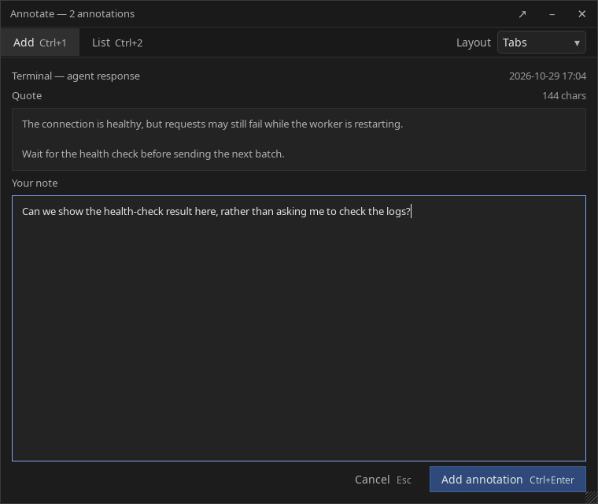
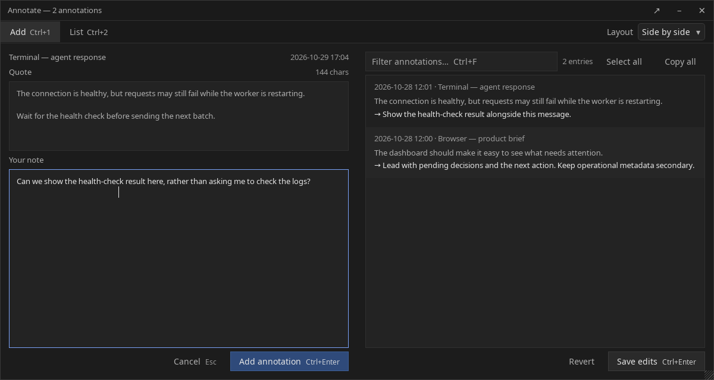
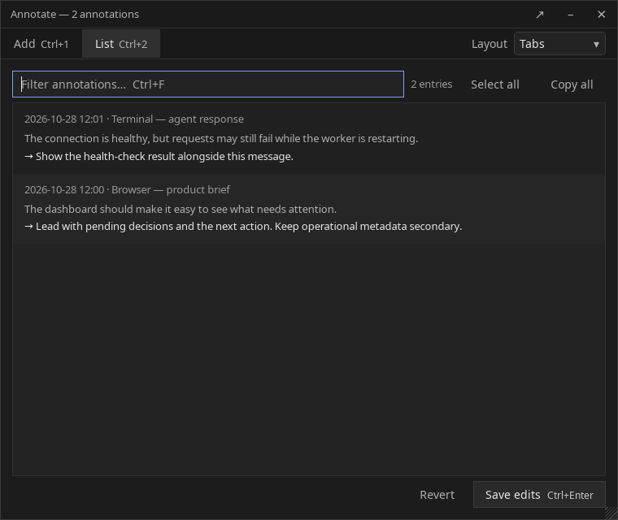

# Desktop Annotator

Grab text from any window on a Linux desktop, write a note next to it, and keep
every note in one plain Markdown file.

It was built for reading what an AI coding agent just said and answering it in
writing, but it does not know or care where the text came from. A browser, a
PDF, a terminal, an editor, a chat window. Anything you can select works.



Select the text, press the shortcut, type the note, press `Ctrl+Enter`. The
window closes and the note is on disk.

## The file

Notes are appended to `~/Annotations/annotations.md`:

```markdown
## 2026-08-22 12:05 · Terminal — cargo build

> warning: unused variable: `attempt`
>    --> src/main.rs:96:13

→ Left over from the focus logging. xdotool windowactivate exits 0 even when it
silently fails, so the only trustworthy signal is whether getwindowfocus
actually reports our window.
```

That is the whole storage format. There is no database and no sync. The
directory and the file are created readable by you only. Set `ANNOTATIONS_DIR`
to keep them somewhere else.

## The list

The List pane is every note you have taken, newest first. Choose `Side by side`
from the labeled `Layout` menu to keep the quote and note input on the left and
the list on the right, or choose `Tabs` to show one pane at a time. The app
remembers that choice for the next launch. Switching layouts keeps your drafts,
filter, selection, Undo history, and any close warning in place. The Add and List
buttons focus the corresponding pane in either layout.



The list is one document
rather than a table of rows, so you can drag a selection across the end of one
note and the start of the next and copy exactly that. Filter with `Ctrl+F`,
copy the selection with `Ctrl+C`, edit any note in place and press `Save edits`
to write the file back.

There are no visible `---` separators between notes. Copying a selection that
crosses notes inserts `---` between the selected note fragments on the clipboard;
`Copy all` also separates notes with `---`. These clipboard separators do not
appear in the editable list, and a selection within one note stays unchanged.

Changed notes show an `edited` marker, and the toolbar counts edited and deleted
notes. `Save edits` turns blue while changes are unsaved; saving or reverting
clears those indicators. Editing a note back to its saved text clears its marker.

Edits stay in the list when you change its filter. `Copy all` copies every note,
including edits hidden by the filter. Removing a whole visible note deletes
that note when you save; notes hidden by the filter are kept.

Saving is blocked if the file cannot be read safely, contains text the list
cannot represent, or has changed outside the window. The list explains the
problem and keeps your drafts available to copy. Copy them before using
`Revert` to reload the file, or before closing and reopening it. For recovery,
you can also reopen with `DESKTOP_ANNOTATOR_UI=gtk` and inspect the Markdown
file in your editor. The external-edit guard is best effort: it detects changes
before saving, but does not lock other editors or merge their changes.

If editing removes a note's quote or comment structure, filtering and saving
pause so your text stays on screen. Use `Ctrl+Z` to undo the edit, or select and
copy the text before reverting.



## Run it

```bash
git clone https://github.com/testy-cool/desktop-annotator
cd desktop-annotator
/usr/bin/python3 annotate.py
```

It has to be the system Python, because that is the interpreter with the GTK
bindings installed. There is nothing to build and nothing to install.

To get the shortcut, link the launcher somewhere on your path and bind it in
your desktop's keyboard settings. On Cinnamon that is Keyboard, Shortcuts,
Custom Shortcuts:

```bash
ln -s "$PWD/annotate.py" ~/.local/bin/desktop-annotator
```

Pressing the shortcut again closes an open window instead of opening a second
one. If two monitors are connected the window opens on the one to the right of
your mouse, so it does not cover what you are reading.

If either tab has unsaved work, closing first shows a warning with
`Keep editing` and `Discard and close`. A second `Esc` or a second press of the
launcher shortcut discards only after its own warning and before any further
typing. The close button, Cancel, and the native window close always need an
explicit `Discard and close` when work is unsaved.

A captured quote alone is not an unsaved draft. Changing that quote or typing a
note makes the Add pane unsaved. `Ctrl+Enter` saves only the active pane: in
Side by side, that is the pane you last focused. If the
List tab has unsaved edits, adding a note takes you there first to save or revert
those edits; your Add draft is kept.

## Shortcuts

| Key | Does |
| --- | --- |
| `Ctrl+Enter` | Save the note, or save your edits in the list |
| `Ctrl+1` | Focus the note input in Add |
| `Ctrl+2` or `Ctrl+L` | Focus the List pane |
| `Ctrl+F` | Filter the list |
| `Ctrl+A` | Select every note in the list |
| `Esc` | Close; warn first if either tab has unsaved work |

The arrow button in the title bar opens `annotations.md` in Sublime Text, if you
have the `subl` command. The HTML interface stays open so unsaved edits remain available.

## Requirements

- Linux running X11. Wayland is not supported.
- Python 3 with PyGObject, GTK 3 and WebKit2GTK 4.1.
- `xclip` and `xdotool`. Also `zenity`, but only for the older GTK window.

Tested on Linux Mint with Cinnamon. Other X11 desktops should work, since the
only desktop specific part is the keyboard shortcut you bind yourself.

## How the text gets captured

Selecting text on X11 usually publishes it to the `PRIMARY` selection. The tool
reads `PRIMARY` and the clipboard once, when you launch it. If `PRIMARY` is
empty, which happens with applications that do not publish it, it sends a brief
`Ctrl+C` and then puts your old clipboard contents back. It does not run in the
background and it does not watch your typing.

## State of it

Rough on purpose. It was written in a few sittings to solve one problem, and it
is small enough to read in an afternoon.

The interface is one HTML file loaded into a WebKit window, so changing how it
looks means editing `desktop_annotator/ui/index.html` and pressing the shortcut
again. That costs about 230ms of startup. Set `DESKTOP_ANNOTATOR_UI=gtk` for the
older plain GTK window, which opens in roughly half the time and has fewer
features.

`rust/` is an abandoned experiment at rebuilding the same thing in Rust and
Slint. It starts slower and uses more memory than the Python version once it
parses a real annotation file, which was the end of that idea. It is kept
because the notes in `rust/README.md` are worth more than the code.

## Tests

```bash
/usr/bin/python3 -m unittest discover -v
```

## Licence

MIT.
